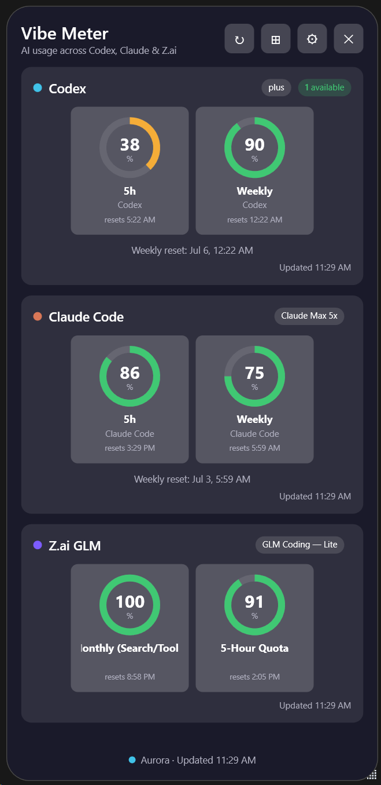

# Vibe Meter

A system-tray widget that monitors **AI usage and rate limits across multiple
providers** — Codex (OpenAI) and Claude Code today, with Z.ai GLM detection — from a
single, always-on-top meter.

Each provider is a plugin implementing `IUsageProvider`; the UI binds identically no
matter the source.



## Provider status

| Provider | Status | How it reads usage |
|----------|--------|--------------------|
| **Codex** (OpenAI) | ✅ Live | `~/.codex/auth.json` → ChatGPT `wham/usage` API (5h + weekly windows) |
| **Claude** | ✅ Live | `~/.claude/usage_cache.json`, else `%APPDATA%\Claude\plan-usage-history.json` (5h + weekly, plan tier) |
| **Z.ai GLM** | ✅ Live | `api.z.ai/api/monitor/usage/quota/limit` via `ZAI_API_KEY` (5h, weekly, monthly) |
| **Google AI Pro** | ⏸ Parked | No public usage API; see [`docs/provider-research.md`](docs/provider-research.md) |

## Install

1. Download **`VibeMeter-win-x64.zip`** from the latest [Release](../../releases).
2. Extract it anywhere.
3. Run `VibeMeter.exe`.

Requirements: **Windows 10/11 x64**. The build is self-contained — no .NET runtime
install required. Sign in to [Codex](https://github.com/openai/codex) and/or
[Claude Code](https://claude.com/claude-code) on the PC, and/or set the
`ZAI_API_KEY` environment variable, for usage data to appear.

### Linux (beta)

A native Linux tray app built on [Avalonia](https://avaloniaui.net/) lives in
`VibeMeter.Avalonia`. There is no release artifact yet — build it from source:

```bash
dotnet run --project VibeMeter.Avalonia/VibeMeter.Avalonia.csproj -c Release
```

It starts minimised to the system tray. Requires a desktop that hosts a
StatusNotifierItem tray: **Cinnamon, KDE and XFCE work**; GNOME needs the
AppIndicator extension.

If no StatusNotifierItem tray is available, the app shows its window at startup and says
so, rather than running with no icon and no way to reach it.

**Known limitations in this beta:**

- Settings are applied on **Save & Close** only — changing a control has no live effect.
- The meter-style setting persists but has no visual effect; gauges always render as bars.
  The Circular and Battery styles are Windows-only so far.
- **"Launch at Login" does nothing on Linux.** The checkbox is live and its value is saved,
  but no autostart entry is written — an XDG `.desktop` entry is not implemented yet. It no
  longer writes a stray Windows batch file into the working directory, which is what it did
  before.
- **Google accounts cannot be added on Linux.** Secret protection is implemented for Windows
  only (DPAPI), and a refresh token will not be stored unprotected, so the flow declines
  before opening a browser instead of failing after you have granted consent.
- **A `settings.json` carried over from Windows keeps working, but is not migrated.** An
  account whose token is still in the clear from a pre-protection build is used as found and
  left exactly as found. Nothing is destroyed, but the plaintext stays in that file until it
  is opened on a host that can protect it. An account already sealed with DPAPI on Windows
  cannot be opened here and is skipped.

## Privacy

VibeMeter is local-first:

- It reads only local provider files (`~/.codex`, `~/.claude`) and, for Codex, calls
  OpenAI's own usage endpoint using the token the Codex CLI already stored.
- It never sends your usage data anywhere, collects no telemetry, and has no accounts.
- Claude usage is read entirely from the local files Claude already maintains (the CLI's
  usage cache or the desktop app's usage history) — no token, no network.

Settings are stored in `%APPDATA%\VibeMeter\settings.json` on Windows and
`~/.config/VibeMeter/settings.json` on Linux. It holds your Google account email list and, if
you enable publishing, the tenant and client ids. On Linux the file and its directory are
restricted to your user.

A Google refresh token is written only in protected form, with one documented exception: a
file carried over from a pre-protection build, opened on a host with no secret store, keeps
the plaintext token it already contained. VibeMeter will not destroy it and will not rewrite
that file — see the Linux beta notes above.

**On Linux, opt-in publishing caches its sign-in token unencrypted.** The Microsoft identity
library's encrypted Linux store needs libsecret and a keyring, which a headless or minimal
desktop may not have, so the cache is written as a plain file readable by your user account
(`~/.config/VibeMeter/`). It is a credential: treat it as one. Publishing is off by default,
and nothing is cached unless you turn it on and sign in.

## Account labels

When two machines publish the same provider from **different accounts** (say, a work
Claude on a Windows PC and a personal Claude on a Linux box), give each machine an
account label so the companion app shows them side by side instead of flipping between
them. A label is 1–32 lowercase letters, digits and hyphens, starting with a letter
(`^[a-z][a-z0-9-]{0,31}$`), e.g. `webcoda` or `personal`.

Set a default for the machine, plus optional per-provider exceptions (e.g. default
`webcoda`, but `codex` → `shared`). With no label configured nothing changes: the
snapshot is byte-for-byte what it was before. An invalid label is ignored with a warning
in the log, and that provider publishes unlabelled (or with the machine default, for an
invalid override) — it never stops publishing.

With a label, each provider object in the snapshot gains two optional fields:

```json
{ "providerId": "claude", "state": "available", "planLabel": "Claude Max 5x",
  "gauges": [ ... ], "accountLabel": "webcoda", "accountKey": "3f9c0a1b7d2e4c58" }
```

`accountKey` is the first 16 hex characters of a salted SHA-256 over the provider id and
the provider's own account identifier — Claude's organisation and account UUIDs from
`~/.claude.json`, Codex's account id from `~/.codex/auth.json`, and for Google the account
email shown on the card. Z.ai holds no account identifier, so it sends the label alone. The
raw identifiers and emails are never sent, logged or stored, and an email is stripped from
any published plan label (the Google card still shows it locally).

**Windows (tray app).** Settings → Publish usage → **Account label**. Per-provider
exceptions are edited in `%APPDATA%\VibeMeter\settings.json`:

```json
"PublishAccountLabel": "webcoda",
"PublishAccountLabelOverrides": { "codex": "shared" }
```

**Linux, or any headless agent.** Set the environment variables — under systemd, in the
unit's `EnvironmentFile` (`/etc/vibemeter/agent.env`, or `~/.config/vibemeter/agent.env`
for the user unit; see `deploy/vibemeter-agent.env.example`), then restart the service:

```ini
VIBEMETER_ACCOUNT_LABEL=personal
VIBEMETER_ACCOUNT_LABEL_OVERRIDES=codex=shared,google=personal
```

For the Windows agent (Scheduled Task), set the same two variables with `setx` for the task
account. The Linux tray app (Avalonia) has the same settings field and `settings.json`
keys as Windows, in `~/.config/VibeMeter/settings.json`.

**Rollout: upgrade the API first; a labelled syncer posting to an old API is rejected with
400 and queues.** A queued snapshot is re-offered a bounded number of times
(`OfflineQueue.MaxRejections`) before it is discarded, so do not leave a labelled syncer
pointed at an old API for long. An unlabelled syncer works against either API version.

### Other machines' accounts in the tray apps

When publishing is switched on and configured, the tray app (Windows, and the Linux
Avalonia app) also reads back the
accounts your other machines publish and shows each one as an extra, read-only card after
the local card of the same provider: e.g. `Claude Code · Personal`, with the same gauges
and a note such as `From another machine · observed 4 min ago`.

- **Which accounts.** Only labelled accounts whose label differs from the one this machine
  publishes for that provider. Unlabelled accounts are never shown, and a provider this
  machine publishes **without** a label shows no other accounts at all, since it cannot
  tell which one is its own. Accounts the other machine reports as disabled or not
  configured are skipped. Claude only for now (`RemoteAccountSelection.SupportedProviders`).
- **How often.** No extra timer: the read runs after a publish attempt, at most once every
  5 minutes, using the publisher's existing sign-in silently (it never prompts). A failure
  keeps the last cards and backs off (10, 20, 40 min, then hourly).
- **Age.** A reading observed more than 20 minutes ago is dimmed and marked
  `last seen 2 h ago`; one older than 24 hours is not shown.
- **Display only.** These cards are never published back from this machine, and they take
  no part in costs, the compact bar or the tray icon.

**Requires the API to offer `GET /api/v1/ai-usage/accounts`** (the same `Usage.Write`
token as publishing). Against an older API the request returns 404, nothing is shown, and
the tray app asks again only once an hour. The headless agent does not read accounts back.

## Build from source

Requires the [.NET 10 SDK](https://dotnet.microsoft.com/download).

```powershell
dotnet build VibeMeter\VibeMeter.csproj
dotnet run --project VibeMeter\VibeMeter.csproj
```

To produce a self-contained single-file release build:

```powershell
dotnet publish VibeMeter\VibeMeter.csproj -c Release -r win-x64 -o publish
```

## Architecture

MVVM + provider plugins. Adding a provider touches only `Providers/<Name>/` plus one
line in `Services/ProviderRegistry.cs`. See `docs/provider-research.md` for the
data-source investigation behind each provider.

```
VibeMeter/
├── Core/        IUsageProvider contract + normalised ProviderUsage model
├── Models/      UI models (gauges, tint, meter style) + SettingsData
├── Providers/   One folder per provider (Codex, Claude, Zai, Google)
├── Services/    SettingsService, ProviderRegistry
├── ViewModels/  MainViewModel (aggregator), ProviderViewModel (one card), Settings
└── Views/       MainWindow (provider cards), SettingsWindow, meter controls
```

## License

[MIT](LICENSE).
